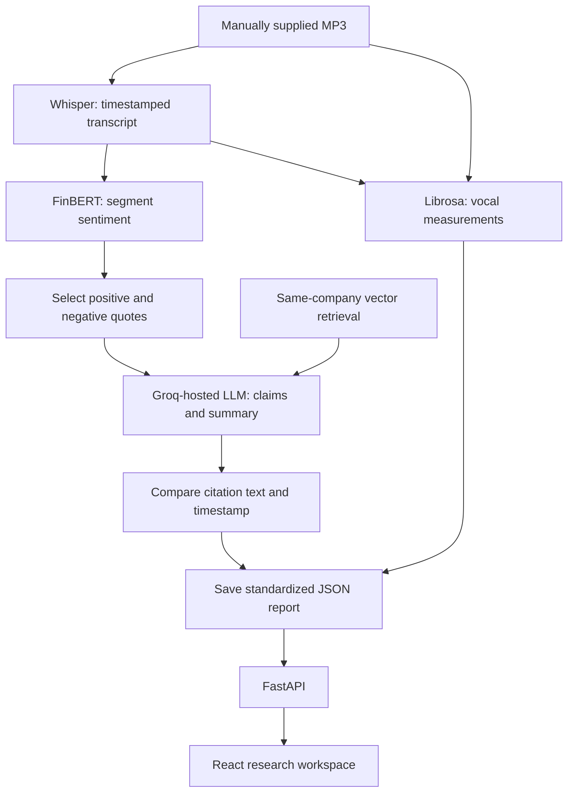

# Candor

### The story behind the numbers.

When a company announces its quarterly results, its leaders discuss how the business performed and answer questions in an earnings call. Their words may sound positive even when their language becomes more cautious or their speaking patterns change. Candor's research goal is to help readers investigate those changes by comparing what an executive says and how they say it with that same executive's earlier calls, then tracing the differences back to evidence.

The current prototype builds part of that workflow: it transcribes recordings, classifies financial sentiment, measures vocal features and generates short briefs from selected quotes. Readers can inspect each claim's source text, surrounding conversation and, when audio is available, the original recording. **Executive-specific historical baselines and communication-anomaly detection are not yet implemented.**

The included dataset covers **16 calls across Apple, Microsoft, Nvidia and Meta**, with four quarters per company. Reports, transcripts and evaluation outputs are committed so the research library can run without model downloads, API keys or a vector database.

**A citation match confirms similar source text near a timestamp. It does not independently verify that the source supports the generated claim.**

[Quick start](#quick-start) · [How it works](#how-it-works) · [Evaluation](#evaluation) · [Known limitations](#known-limitations) · [Deployment](#deployment)

## Research question and current scope

The central question is: **Does an executive communicate differently from their own usual pattern, and where does that change appear?** Someone who naturally speaks slowly should not be treated as unusual simply because another executive speaks faster. A meaningful comparison needs the same person's historical baseline, comparable passages and evidence a reader can inspect. A detected change would be a reason to investigate, not proof of nervousness, dishonesty or future stock performance.

| Part of the intended workflow | Current implementation |
|---|---|
| Analyse what was said | Segment-level financial sentiment and claims generated from selected quotes; no dedicated hedging or uncertainty detector |
| Analyse how it was said | Descriptive pitch, energy, pause and speaking-rate measurements |
| Compare the same executive across calls | Not implemented; speakers are not identified |
| Detect unusual changes against a historical baseline | Not implemented; no calibrated communication-anomaly score |
| Retrieve relevant historical evidence | New retrieval uses the same company and strictly earlier recorded call dates; older saved reports still need regeneration and topic-specific comparisons need work |
| Explain findings with inspectable evidence | Claim-to-quote, transcript and audio navigation exists; explanations of historical communication changes are future work |

The current interface demonstrates the available analysis and evidence trail. The longer-term research direction is to connect language and vocal measurements through speaker-aware historical comparisons.

## Research workflow

- **Research desk:** browse reports, filter by company and search by company, ticker or quarter. Library figures come from the API.
- **Earnings brief:** read the summary, inspect transcript sentiment and view descriptive vocal measurements.
- **Claims and evidence:** follow a claim to its citation-match verdict, source quote and surrounding transcript passages.
- **Audio navigation:** select a timestamp to seek the source player; the evidence view highlights the cited passage in a waveform.
- **Methodology and evaluation:** inspect recorded baseline/structured results and per-call claim-coverage scores, with incomplete human review clearly labelled.

The frontend includes responsive layouts, keyboard-operated report tabs and reduced-motion support. It opens immediately with a clearly labelled bundled demo, then replaces each resource with validated FastAPI responses as they arrive.

### Instant demo and backend connection

The frontend bundles curated copies of four existing reports (one per company), their claims, 115 transcript excerpts and a recorded evaluation snapshot. This is demonstration data from project outputs, not invented metrics or a live benchmark run. Full recordings and full transcripts are not bundled. Reports outside the sample set offer a link to an available example while their live response is pending.

A shared client checks the existing `/companies` endpoint in the background. The header shows **Connecting to live analysis…**, **Live data** after a valid response, or **Interactive demo** after all automatic connection attempts fail. It stays in the connecting state during cold-start retries while the bundled demo remains usable. Every content section separately identifies demo versus live data, including partial availability. The connection label describes backend availability; it does not imply that all visible sections have already switched to live data.

Requests time out after twelve seconds. Failed connections retry up to five times with delays of 2, 4, 8, 16 and 30 seconds; a manual retry remains available afterward. Failed content requests retain their bundled sample or previous live response. Shared caching, cancellation and request revisions prevent duplicate or stale requests from replacing newer data. Demo timestamps preview transcript passages without pretending to play audio. Optional web fonts load without blocking the first render.

To refresh the curated snapshot from the current stored outputs, run `npm run demo:build` in `frontend/`. This only updates the frontend's demo file; it does not alter API responses or rerun evaluation.

Audio playback requires the source MP3 to be available on the API server. A fresh clone and the public read-only deployment provide text-based research without those recordings.

## Quick start

Prerequisites: Python with `venv`, and Node.js **20.19+ within the 20.x series, or 22.12+** as required by the current Vite package. The existing local Python environment uses Python 3.13.

Clone the repository:

```bash
git clone https://github.com/Kruthi-choudary/candor-research.git
cd candor-research
```

**Terminal 1 — API serving the included reports:**

```bash
python3 -m venv .venv
source .venv/bin/activate
python -m pip install -r requirements-api.txt
READ_ONLY_MODE=true python -m uvicorn api.main:app --host 127.0.0.1 --port 8321 --reload
```

**Terminal 2 — frontend, starting from the repository root:**

```bash
cd frontend
npm ci
npm run dev
```

Open the URL Vite prints, normally **http://localhost:5173**. API documentation is at **http://127.0.0.1:8321/docs**. Vite proxies frontend `/api` requests to the backend on port `8321`. The frontend also works on its own: skip Terminal 1 to explore the bundled demo, with the connection status showing that live analysis is unavailable.

This path does not install Whisper, FinBERT, the embedding model or Groq dependencies. `POST /analyze` returns `403` in read-only mode. Missing audio is reported in the interface while reports and transcripts remain usable.

## How it works



[`pipeline.py`](pipeline.py) coordinates the processing stages:

1. **Transcription:** `faster-whisper`, configured with `base.en`, converts the recording into text segments with start and end times.
2. **Sentiment:** `ProsusAI/finbert` classifies each non-empty segment as positive, negative or neutral. The reported distribution is the percentage of segments in each class, not a measure of investor opinion.
3. **Vocal measurements:** `librosa` extracts pitch, energy, pauses and speaking rate. These are summarized alongside the report; they are not inputs to claim generation.
4. **Retrieval:** LlamaIndex queries PostgreSQL/pgvector using `BAAI/bge-small-en-v1.5` embeddings. Before vector search, metadata filters restrict candidates to the same company and quarters with recorded call dates strictly earlier than the target call. Returned results are checked against that eligibility list again. New regeneration uses selected current-call passages as search topics, taking distinct results across topics; its earlier fixed query repeatedly returned off-topic context for Apple. The earliest dated call needs no search. Scheduled dates have primary-source records in `data/processed/call_date_sources.json`; recording identity remains unverified. New report regeneration stops if an eligible historical search fails or returns no passages; the older processing path still logs the failure and continues without context. **All 16 reports have been regenerated and AI-assisted reviewed against saved transcripts; independent human and recording review remain pending.** The Apple Q2 and Q3 historical passages were source-correct but excluded after review because they did not support clear communication comparisons. Meta Q1 through Q3 and Nvidia Q1 through Q3 include earlier-call business context, but no executive communication baseline has been evaluated.
5. **Generation:** the configured Groq-hosted model, `openai/gpt-oss-120b`, receives sentiment percentages, up to four passages selected from positive seeds and four from negative seeds, and optional retrieved context. New generation joins adjacent segments through sentence boundaries and asks for at most six supported claims, no more than one per passage, plus a short summary in a JSON-schema-constrained response. The model selects a current-call passage ID for each claim; application code inserts that passage's exact text and timestamp into the existing citation format. Unknown or repeated IDs stop staging, and the citation evaluator independently checks the resulting passages. This avoids asking the model to recopy long evidence verbatim; it does not establish that a claim is true. The prompt guards against confusing a percentage level with a percentage decline or a segment metric with total-company revenue. Claim sentiment is assessed independently of the seed's label. **It does not receive the full current-call transcript.** Existing saved reports were generated from isolated quotes.
6. **Citation matching:** new complete-passage reports require an exact passage copy and its integer start timestamp. Legacy reports use normalized text similarity against a `0.6` threshold for segments starting within two seconds of the citation. Match results are recorded before the standardized report is saved; a failed match does not automatically remove the claim. Neither procedure verifies the meaning of the generated claim.

The final output contains claims, evidence, timestamps, sentiment distribution, citation-match counts, audio-feature summaries, retrieved context and stage durations. See an [included Apple report](data/processed/pipeline_runs/AAPL/Q1_2025.json) and the [report contract](src/common/schema.py). `risks` and `management_outlook` are reserved fields and currently empty.

### Architecture and storage

The React SPA initially renders a bundled sample and requests live data from FastAPI in the background. The API reads saved JSON reports and intermediate outputs from `data/processed/`. In local processing mode, it can also invoke the pipeline. PostgreSQL/pgvector holds the optional retrieval index; it is not the main report store.

Vite suits the existing client-rendered research interface: report selection, evidence navigation and playback happen in the browser. The hosted frontend uses a rewrite to `index.html` so direct links and refreshes work with React Router.

| Layer | Implementation |
|---|---|
| Frontend | React 19, TypeScript, Vite 8, Tailwind CSS 4, React Router |
| Audio interface | Native audio controls and WaveSurfer.js |
| API | FastAPI and Uvicorn |
| Speech recognition | faster-whisper / `base.en` |
| Financial sentiment | Transformers / `ProsusAI/finbert` |
| Vocal measurements | librosa |
| Retrieval | LlamaIndex, PostgreSQL/pgvector, Hugging Face embeddings |
| Generation | Groq API with structured JSON output |
| Configuration | YAML files in `config/` |

These are integrations with existing models; the project does not train or fine-tune them. Dependency versions are recorded in the requirements files and frontend lockfile.

## Evaluation

### Citation matching

Recorded results from [`data/processed/eval/`](data/processed/eval/):

| Measure | Free-text baseline | Structured JSON |
|---|---:|---:|
| Citation-match rate | 81.4% | 100.0% |
| Citations matched | 70 / 86 | 128 / 128 |
| Recorded format-compliance value | 81.2% | 100.0% |

These are archived results from the original experiment; they do not evaluate newly regenerated reports. They do **not** establish 100% factual accuracy, complete claim support or the absence of hallucinations. Current report citation matches are stored separately in per-call evaluation files.

The comparison changes both generation format and checking procedure: the baseline uses regex parsing and a one-second timestamp tolerance; the structured checker uses a two-second tolerance and selects the most text-similar nearby segment. This is not a controlled experiment isolating the effect of JSON schema. The structured checker's format-compliance field counts processed report files against an expected 16; it is not an independent schema-validation score.

### Claim coverage

The coverage script greedily matches generated claims to reference claims using normalized text similarity with a `0.5` threshold.

The figures below and the evaluation page's coverage snapshot describe the archived generation run, not the corrected Apple report. No new claim-correctness or communication-deviation performance has been established.

| Call | Reference-label provenance | Precision | Recall | F1 |
|---|---|---:|---:|---:|
| AAPL Q1 2025 | Documented as human-labelled | 0.625 | 0.714 | 0.667 |
| META Q1 2025 | AI-drafted; human review pending | 0.750 | 0.750 | 0.750 |
| MSFT Q1 2025 | AI-drafted; human review pending | 0.875 | 0.875 | 0.875 |
| NVDA Q1 2025 | AI-drafted; human review pending | 0.875 | 0.875 | 0.875 |
| **Mean across four calls** | **Mixed provenance** | **0.781** | **0.803** | **0.792** |

The Apple provenance follows the repository's existing documentation; the other three [reference files](data/eval_labels/) explicitly carry `ai_drafted_pending_human_review`. The mean is not an independently human-validated quality score. Text similarity can also miss equivalent paraphrases or accept similar wording with different meaning.

### Recompute checks on saved outputs

With the API dependencies installed and the virtual environment active, run from the repository root:

```bash
python -m src.eval.check_citations_structured
python -m src.eval.check_claim_coverage
python -m src.eval.compare_runs
```

The first two commands recompute evaluation summaries from existing files without model calls or audio. They overwrite their corresponding saved summaries. `compare_runs` formats the saved baseline and structured results into `comparison.md`; it does not regenerate reports or rerun the original experiment. Per-call citation files served by the claims endpoint are written separately by `pipeline.py`.

### Historical-retrieval regression checks

```bash
python -m unittest discover -s tests -v
```

The tests cover strictly earlier dates, same-day exclusion, company isolation, missing dates, unavailable retrieval, result limits and the included dataset's chronology. They require no audio, model downloads or live database. An additional adapter test checks the installed LlamaIndex filter types with model and database operations substituted; it is skipped when those optional dependencies are unavailable.

### Complete evidence passages

New structured generation expands sentiment-selected segments into contiguous passages through sentence boundaries. It retains unscored neighbouring text, preserves numeric ranges and negations, and avoids overlapping selections. For example, Apple's split statement `grow low to` now includes `mid-single digits year-over-year.` rather than presenting the first fragment alone.

Passages are limited to 12 segments, 220 words and 90 seconds, with no gap over 2.5 seconds between joined segments. Incomplete passages that cannot fit these limits are skipped. Known speaker-label changes are respected when labels exist; the included transcripts still lack speaker identification. Punctuation is only a boundary heuristic and does not guarantee complete meaning or context. FinBERT scores belong to the original seed segments, not the expanded passages.

Preview the exact selected passages without audio, model inference, network requests or file changes:

```bash
python -m src.report.evidence --ticker AAPL --quarter Q1-2025
```

New structured outputs carry `evidence_policy: complete_passages_v1`. Generation rejects citations that do not exactly copy a supplied passage and its integer start timestamp. Citation evaluation for these reports checks complete passages with exact text matching. Older reports retain their original matching behaviour and need deliberate regeneration; these code changes do not repair existing generated claims or alter the saved benchmarks. The original free-text baseline is preserved for comparison.

The Python regression suite above also checks split ranges, recovered negations, punctuation edge cases, size limits, gaps, duplicate passages, strict citations and all 16 included calls. A substituted generation client tests prompt inputs and citation rejection without calling an LLM; that test is skipped if optional generation dependencies are absent. Claim correctness still requires separate review.

### Stage a regenerated report without audio

With the full pipeline dependencies installed and `GROQ_API_KEY` configured in `.env`, stage a fresh candidate from saved transcripts and sentiment:

```bash
python -m src.report.regenerate --ticker AAPL --quarter Q1-2025 --without-history --output /tmp/candor-aapl-q1-2025-candidate.json
```

This makes one generation request and writes a separate candidate bundle containing structured claims, citation checks, the API-shaped report and review metadata. The existing report supplies its descriptive audio summary, explicitly marked as reused rather than recomputed. No recording, Whisper run or sentiment-model run is required. The source transcript and saved sentiment text must agree, and unmatched citations stop staging.

`--without-history` deliberately excludes all historical context for a current-call-only review. Omit that flag to use fresh date-filtered vector retrieval; if eligible history exists, an unavailable or empty search stops staging. Retrieved text must also match the saved earlier transcript at its source timestamp before a model request is made. Cached context from the previous report is never reused. Scheduled call dates have primary-source records; recording identity and exact audio alignment remain unverified. The command will not overwrite an existing output file.

Review every candidate claim against its full passage, including numbers, ranges, qualifications and attribution. A successful citation check is not a claim-support review. Staging does not update served reports, per-call verdicts, the bundled frontend demo or archived evaluation results; these must be updated coherently after review. The test suite covers staging failures, missing audio, stale transcript inputs and preservation of existing outputs.

### Audit and regenerate saved reports

[`call_date_sources.json`](data/processed/call_date_sources.json) records company announcement links for all 16 scheduled calls, checked on October 16, 2026. All scheduled dates agree with the existing registry; no call dates were changed. Apple, Microsoft and Nvidia use their fiscal-quarter labels, while Meta uses calendar quarters. These source checks do not authenticate the downloaded recordings or validate individual claims. They are AI-assisted source checks, not fabricated human labels.

Run the offline integrity audit:

```bash
python -m src.eval.audit_reports --output data/processed/audits/report_integrity.json
```

The audit is reproducible from recorded input hashes and does not modify served data or archived benchmarks. After all 16 AI-assisted updates, the current audit finds zero reports requiring regeneration, zero nonhistorical context passages, and zero citations that fail the exact complete-passage check. These are integrity checks, not proof that every claim is correct or that a communication deviation has been evaluated. All saved transcript and sentiment segment texts agree. The date check validates curated source records against the registry; it does not fetch the websites on each audit run.

Preview the queue. If a future audit identifies legacy reports, generate one candidate at a time:

```bash
python -m src.report.regenerate_remaining
python -m src.report.regenerate_remaining --execute --limit 1
```

The queue skips already corrected reports and orders each company's calls by date. It currently has no pending legacy calls. Candidates were saved under `data/processed/report_candidates/remaining/`, and reviewed versions under `data/processed/report_candidates/reviewed/`. Repeating the command resumes without replacing existing candidates; changed source/configuration/context hashes, mismatched identities and inconsistent history modes stop the run. Requests are sequential, use a 30-second timeout without hidden retries, and stop at the first failure while preserving completed files. Remove `--limit 1` to stage all pending calls if future legacy calls are identified.

Fresh historical retrieval is the default. For calls with eligible earlier history, an unavailable or empty search now stops staging. `--without-history` explicitly chooses current-call-only generation and does not test retrieval. Generation snapshots the transcript, sentiment, previous report, date sources, configuration and generation code before requesting claims; changed files or a different generator transcript snapshot prevent staging. Each candidate still requires review and explicit versioned promotion. No report is automatically published by this batch command.

### Reviewed, versioned report updates

Apple Q4 2024 uses version `complete-passages-b8e1d3ead46d`. Review retained three of six generated claims, removed three context-dependent or insufficiently specific assertions, corrected the capital-expenditure attribution, and rebuilt the summary. The original generated candidate, review decisions and previous served report are preserved. In particular, a sentence describing China as relatively flat had been wrongly summarized as Apple overall being flat, despite an exact citation match. This demonstrates why punctuation completeness and citation matching cannot replace subject/context review. No earlier Apple call is available in this dataset, so this report contains no historical comparison. Independent human review is pending.

Apple Q1 2025 now uses version `complete-passages-fc37b1640da2`: eight complete-passage citations match, the summary and management attribution have been corrected, and historical context was explicitly omitted. The review is AI-assisted against saved transcript text; independent human review remains pending. External date verification was pending at promotion; a later primary-source check is recorded separately in `call_date_sources.json` without rewriting the archived publication. This is not a validated historical communication analysis.

Apple Q2 2025 uses version `complete-passages-1fb9bab5129f`. The generated candidate had eight exact citation matches, but review retained six claims and corrected the China subject, the March-quarter EPS record attribution and the foreign-exchange qualifier. One ambiguous services claim and a separate claim based only on an analyst question were removed. The three retrieved earlier-call passages passed source and date checks but did not provide a clear comparison for this brief, so the published report contains no historical context. Both the original candidate and the reviewed decisions are retained, with independent human review pending.

Apple Q3 2025 uses version `complete-passages-adc355d4fc98`. Review retained five distinct claims from seven generated claims and corrected a summary that incorrectly assigned 12% year-over-year growth to net income; the saved statement assigns that rate to diluted EPS. The retrieved earlier-call passages were source-correct but off-topic or noisy for this brief, so none appears as historical context in the published report. Independent human review and recording verification remain pending.

Meta Q4 2024 uses version `complete-passages-97649279306c`. Seven generated claims had exact transcript citations; review clarified geographic ad growth rates, simplified a crowded segment claim and marked the Community Notes statement as a speaker's expectation rather than a measured outcome. The summary no longer describes 15–16% cost increases as modest or asserts a broad positive outlook. This is the earliest included Meta call, so no historical comparison is possible; independent human and recording review remain pending.

Meta Q1 2025 uses version `complete-passages-40e17cd2837e`. Eight claims retain exact current-call citations. Review removed an unsupported statement that Reality Labs' $4.2 billion operating loss was widening, because the retrieved Q4 call reported a $5 billion loss. The topical search found Q4 Meta passages on regional ad revenue, expenses and Reality Labs; the served report uses shorter exact excerpts, while its review record preserves the original retrieved chunks. Its Q4-to-Q1 figures are descriptive business context, not a finding about an executive's language or voice. Independent human and recording review remain pending.

Meta Q2 2025 uses version `complete-passages-356c86ea735c`. All eight claims retain exact current-call passages. Review removed an unsupported “record” revenue description from the summary, made the possible EU revenue impact conditional on further required changes to Meta's less-personalized ads offering, and retained the caveat that Meta did not provide a Q4 revenue forecast. Two short, source-checked Q4 and Q1 excerpts give earlier ad impression and price-per-ad figures; a third, off-topic retrieved passage was excluded. These are descriptive business metrics, not a measured change in executive communication. Independent human and recording review remain pending.

Meta Q3 2025 uses version `complete-passages-fd7b95322459`. Eight current-call claims have exact complete-passage citations. Review replaced a citation whose “that offering” reference was unclear in isolation with a complete regulatory-headwinds passage, removed the summary's unsupported demand inference, and clarified that the 87% reported tax rate was affected by a one-time non-cash charge. Of three retrieved older chunks, only a short Q2 tax-outlook excerpt was retained; the Q1 analyst question and Q4 legal-expense passage did not support a clear communication comparison. Independent human and recording review remain pending.

Microsoft Q4 2024 uses version `complete-passages-0d767ce5e3ac`. Review retained four generated claims and added one directly supported FY2025 operating-margin outlook from a passage already supplied to the generator. It excluded a search-advertising X-TAC claim whose isolated wording could be mistaken for total-company revenue, and a cloud-margin claim whose approximately 70% margin level was misread in the generated summary as a 70% decline. This is the earliest Microsoft call in the dataset; later-call context from the old report was removed. Independent human and recording review remain pending.

Microsoft Q1 2025 uses version `complete-passages-405686888962`. Five claims retain exact current-call citations. Review removed an isolated statement that margins were up after excluding Activision's impact because the generated summary presented it as an overall margin increase; the surrounding transcript says reported operating margin was down about one point. A 71% Microsoft Cloud gross-margin level is retained without interpreting the transcript's ambiguous “2.0” as a verified unit. Three retrieved Q4 chunks were excluded as off-topic, diffuse or transcription-ambiguous, and the old report's future-call context was removed. Independent human and recording review remain pending.

Microsoft Q2 2025 uses version `complete-passages-a22658bc0cde`. Five generated claims retain exact current-call citations. Review removed a gross-margin claim because the saved passage stated an increase of “6.0” without a clear unit or standalone segment scope, while the generated summary asserted six percentage points. It kept Xbox, M365 commercial-products, free-cash-flow, on-premises server and enterprise-services figures with their qualifiers. One short Q1 free-cash-flow excerpt was retained as descriptive business context; two other retrieved chunks were excluded. Independent human and recording review remain pending.

Microsoft Q3 2025 uses version `complete-passages-271df70f9ef8`. Five claims retain exact current-call citations. Review corrected a combined enterprise-and-partner-services growth rate that the draft had split into separate businesses, and clarified that roughly 67% was the projected Q4 Cloud gross-margin level, not a 67% decline. A vague Q&A claim and three retrieved chunks without a focused communication comparison were excluded. Independent human and recording review remain pending.

Nvidia Q4 2024 uses version `complete-passages-491286801364`. Six claims retain exact current-call citations. Review corrected the $1.55 billion fiscal-year figure to Professional Visualization revenue, normalized the InfiniBand name, and clarified that the shipment-pause decline concerned China rather than Nvidia's entire business. These subjects were cross-checked against Nvidia's [fiscal 2024 CFO commentary](https://investor.nvidia.com/files/doc_financials/2024/Q4FY24/Q4FY24-CFO-Commentary.pdf) and [earnings release](https://investor.nvidia.com/news/press-release-details/2024/NVIDIA-Announces-Financial-Results-for-Fourth-Quarter-and-Fiscal-2024/). This is the earliest Nvidia call in the included dataset, so no historical comparison is possible. Independent human and recording review remain pending.

Nvidia Q1 2025 uses version `complete-passages-344c2e5dce4a`. Six claims retain exact current-call citations. Review corrected Whisper's “gap growth margin” and “non-gap” wording to GAAP and non-GAAP gross margin, paired the 10% and 13% sequential expense increases with their respective accounting categories, and clarified the China Data Center scope. Two shorter Q4 excerpts document the previous Q1 outlook and gaming revenue, but these are business context rather than an executive communication baseline. The figures were cross-checked against Nvidia's [Q1 fiscal 2025 results](https://investor.nvidia.com/news/press-release-details/2024/NVIDIA-Announces-Financial-Results-for-First-Quarter-Fiscal-2025/). Independent human and recording review remain pending.

Nvidia Q2 2025 uses version `complete-passages-e6b57e536067`. Five claims retain exact current-call citations. Review corrected Whisper's GAAP/non-GAAP operating-expense wording, specified the Automotive revenue category, and marked the MLPerf result as Nvidia's own claim rather than an independently checked benchmark. Three short excerpts from Q4 and Q1 show earlier Automotive and Gaming revenue as business context. The original retrieved chunks were mostly too long or off-topic; the review record distinguishes trimmed retrieval from passages manually selected in saved earlier transcripts. The financial figures were cross-checked against Nvidia's [Q2 fiscal 2025 results](https://investor.nvidia.com/news/press-release-details/2024/NVIDIA-Announces-Financial-Results-for-Second-Quarter-Fiscal-2025/default.aspx). Independent human and recording review remain pending.

Nvidia Q3 2025 uses version `complete-passages-be6cb0d7a6c2`. Six claims retain exact complete-passage citations. Review removed a 15% networking decline claim whose cited passage was only an analyst question, replaced an analyst-question citation for Blackwell gross-margin guidance with management's actual answer, and identified the otherwise ambiguous $486 million revenue figure as Pro Visualization. A $35.1 billion company-revenue claim was added from a complete current-call passage and checked against Nvidia's [Q3 fiscal 2025 results](https://investor.nvidia.com/news/press-release-details/2024/NVIDIA-Announces-Financial-Results-for-Third-Quarter-Fiscal-2025/default.aspx). Two short Q2 financial excerpts replace off-topic retrieved chunks; they do not establish an executive communication deviation. Independent human and recording review remain pending.

For a newly reviewed candidate, preview the update first:

```bash
python -m src.report.promote path/to/reviewed-candidate.json
```

The preview recomputes citation matches, checks report/claim consistency, recorded dates, sentiment distributions and reused audio measurements. Any historical context must come from a strictly earlier same-company transcript at its recorded timestamp. It also constructs the proposed demo and verifies that full cited passages can be included. Every claim must have a recorded support assessment; this is an audit requirement, not proof that the assessment is correct.

To explicitly apply the previewed candidate, use `--apply --expected-sha256` with the full checksum printed by the preview. Changed inputs, stale evaluation, unknown versions and already-active candidates are rejected. The command archives both report bundles and checksums under `data/processed/report_versions/`, then replaces structured claims, per-call evaluation, the API-shaped report and the bundled demo. It reads back the outputs and restores changed files on ordinary write failures. It does not provide a transaction across a running server or protection from process termination; commit the entire change together and use the existing deployment process to publish it. No deployment is triggered by the command itself.

The archive preserves the previous report and the AI-assisted review record. Configuration and input hashes identify the promotion inputs; the first Apple generation request predates full request-provenance recording, which is explicitly documented in its archive. Future generated candidates also record model settings, response ID, prompt/code/input hashes and dataset scope. Original evaluation snapshots remain unchanged and are labelled as archived experiments in both the API and UI.

### Frontend connection and fallback tests

With Node.js 24, run from `frontend/`:

```bash
npm test
npm run build
npm run lint
```

The dependency-free Node tests check immediate demo state, timeout and bounded retries, automatic recovery, partial failures, cache sharing, stale-response cancellation, response validation and sample-data shapes. They substitute transport responses rather than making calls to Render. They do not test browser audio decoding or visual layout.

## Run the processing pipeline locally

Full processing requires the heavier dependencies, source audio and a Groq key whenever new claims are generated. Models may download on first use.

From the repository root, with the virtual environment active:

```bash
python -m pip install -r requirements.txt
cp .env.example .env
```

Set `GROQ_API_KEY` in `.env`. Supply a recording at `data/raw/audio/{TICKER}/{QUARTER}.mp3`, for example `data/raw/audio/NVDA/Q1_2025.mp3`, then run:

```bash
python pipeline.py --ticker NVDA --quarter Q1-2025
```

**The pipeline checks for the MP3 before using cached outputs. Audio is required even when transcripts and features already exist.** Existing transcript, sentiment, audio-feature and claim files are reused by default. Retrieval and citation matching still run. Use `--force` only when you intend to recompute all cached stages, including transcription and audio features:

```bash
python pipeline.py --ticker NVDA --quarter Q1-2025 --force
```

To enable the local processing API after installing the full dependencies:

```bash
READ_ONLY_MODE=false python -m uvicorn api.main:app --host 127.0.0.1 --port 8321 --reload
```

The frontend currently browses saved reports; there is no upload or analysis-submission interface. The processing endpoint is synchronous and has no authentication, so the public deployment disables it.

For optional retrieval, configure a PostgreSQL database with the `vector` extension, update the connection settings in `config/pipeline.yaml`, and build the index:

```bash
python -m src.rag.build_index
```

The index is built from saved transcripts with deterministic chunk IDs. Before loading the embedding model, the builder checks the target database. An identical index with a matching `.local/index_manifest.json` is reused without appending rows. A nonempty index that differs from the expected IDs or manifest is rejected; the command never silently clears or appends to it. After a fresh build, stored IDs must match the expected unique chunks before a manifest is saved. Historical filtering uses ticker and quarter metadata; dates are applied at retrieval time.

## API

| Method | Path | Purpose |
|---|---|---|
| GET | `/companies` | Configured company names and tickers |
| GET | `/calls` | Saved report summaries |
| GET | `/calls/{ticker}/{quarter}` | Standardized report |
| GET | `/calls/{ticker}/{quarter}/claims` | Claims with citation-match verdicts |
| GET | `/calls/{ticker}/{quarter}/transcript` | Timestamped transcript |
| GET | `/calls/{ticker}/{quarter}/audio` | MP3 when available; otherwise `404` |
| GET | `/eval/summary` | Saved citation and coverage results |
| POST | `/analyze?ticker=NVDA&quarter=Q1-2025` | Run the local pipeline; `403` in read-only mode |

Quarter inputs accept forms such as `Q1-2025` and `Q1_2025`. Interactive documentation is available at `/docs`.

## Project structure

```text
api/                    FastAPI routes and deployment-mode handling
config/                 Company registry and pipeline settings
src/
  common/               Call paths, configuration, report shape and errors
  data/                 Transcription and supporting data-collection scripts
  nlp/                  FinBERT sentiment classification
  audio/                Vocal-feature extraction
  rag/                  Vector indexing and historical retrieval
  report/               Free-text baseline and structured generation
  eval/                 Citation checks and claim-coverage evaluation
  analysis/             Separate stock-price reaction analysis
pipeline.py             Single-call processing coordinator
data/
  processed/            Included transcripts, reports, features and evaluations
  eval_labels/          Reference claims and available provenance metadata
  raw/                  Local source recordings and downloads; gitignored
frontend/               React interface, shared connection client and bundled demo
tests/                  Historical-retrieval regression checks
render.yaml             Read-only API deployment configuration
```

### Exploratory stock-price comparison

The separate price-reaction script compares a closing price on or before the recorded call date with the next available trading day's close, alongside transcript sentiment. Its current flag uses an absolute price-move threshold of 5%; it does not estimate what return should be expected from the call's tone. This price reference is not an executive's communication baseline, and the flag is not a statistically validated anomaly or a causal explanation of market movement.

The price-reaction and SEC-filing scripts are supporting experiments. They are not part of the main claim-generation workflow or currently exposed as frontend research features. Price-window alignment with the actual call time needs validation before drawing event-study conclusions.

## Deployment

The repository supports a **read-only public demo**: the frontend browses included results while the API serves JSON files. No model inference or audio hosting is required for that mode.

| Setting | Render API | Vercel frontend |
|---|---|---|
| Repository | `Kruthi-choudary/candor-research` | `Kruthi-choudary/candor-research` |
| Branch | `main` | `main` |
| Root directory | Repository root | `frontend` |
| Build command | `pip install -r requirements-api.txt` | `npm run build` |
| Start / output | `uvicorn api.main:app --host 0.0.0.0 --port $PORT` | Output directory: `dist` |

Set `READ_ONLY_MODE=true` on the API and `ALLOWED_ORIGINS` to the exact frontend origin, without a trailing slash. Multiple origins can be comma-separated. Set the frontend's build-time `VITE_API_BASE_URL` to the API origin, without a trailing slash or `/api` suffix. For example, an API hosted at `https://your-api.onrender.com` serves `/calls` directly.

`READ_ONLY_MODE` and `ALLOWED_ORIGINS` are read from the API process environment; the API does not automatically load them from `.env`. `render.yaml` defines the read-only setting. `frontend/vercel.json` contains the SPA rewrite. Backend hosts that suspend idle services can make the first request slower.

## Speaker attribution pilot

The first speaker-attribution milestone records **provisional** handoff labels for the prepared remarks in Nvidia Q4 2024 and Q1 2025. The operator introduces Investor Relations, Investor Relations hands off to CFO Colette Kress, and the Q1 CFO remarks hand off to CEO Jensen Huang. Nvidia's 2024 [Q4](https://investor.nvidia.com/news/press-release-details/2024/NVIDIA-Announces-Financial-Results-for-Fourth-Quarter-and-Fiscal-2024/) and [Q1](https://investor.nvidia.com/news/press-release-details/2024/NVIDIA-Announces-Financial-Results-for-First-Quarter-Fiscal-2025/) materials corroborate the named participants and roles. Exact segment ranges, handoff text, source URLs and transcript/audio hashes are saved under `data/processed/speaker_annotations/pilot/NVDA/`.

Run `.venv/bin/python -m src.speakers.annotations` to validate both records. The pilot covers 199 of 525 Q4 transcript segments and 308 of 751 Q1 segments. It deliberately leaves mixed handoffs and all Q&A turns unlabeled. **No voice identity has been confirmed from the recording, and zero pilot segments are eligible for executive baselines.** The validator rejects changed source files, overlapping ranges, inconsistent cross-call identity keys and premature baseline use. The next step is to listen to the saved recordings at each handoff, adjust turn boundaries, and verify speaker identity before extending labels to Q&A or other companies.

To prepare that listening review locally, run `.venv/bin/python -m src.speakers.review_packet` and open `.local/speaker_review/index.html` in a browser. The command validates source hashes first, then cuts short clips around each proposed handoff and the two unlabeled Q&A boundaries. The clips and review page stay under ignored `.local/`; this command does not change speaker labels or certify identities. Compare Colette Kress's Q4 and Q1 samples, note any mixed transcript segments, and leave uncertain voices unassigned.

## Known limitations

- **Evidence scope:** all 16 current reports now pass the exact complete-passage integrity check and have AI-assisted claim reviews. Punctuation and matching still cannot prove that every claim is correct; independent human and recording review remain pending.
- **Selection bias:** generation sees sentiment-selected quotes, not a comprehensive selection of financial facts or the full transcript.
- **Historical-context relevance:** current reports contain no later-quarter passages, but source-correct earlier business figures are not yet evidence of an executive communication change.
- **Date provenance:** recorded dates agree with company announcements for the 16 scheduled calls, with source links and checking scope retained. The recordings' identities, actual occurrence and exact audio/time alignment are not independently verified; scheduled dates alone do not establish those facts.
- **Limited verification:** citation matching checks text and time; AI-assisted review has checked claim support against saved transcripts, but no independent human or recording-level verification has been completed.
- **Limited reference labels:** only four calls have reference claims, three sets await human review, and provenance has not been independently audited.
- **No verified speaker identification:** transcript segments have no speaker labels. The two separate Nvidia pilot files contain provisional prepared-remarks labels only; Q&A and all other calls remain unlabeled.
- **No historical communication baseline:** whole-call features mix speakers and passages; they cannot currently establish that a particular executive behaved unusually compared with their own history.
- **Descriptive audio only:** vocal measurements are not validated indicators of confidence, deception or financial performance.
- **File-based caching:** cache reuse depends on file existence, without automatic invalidation when prompts, models or configuration change.

## Planned improvements

These are outstanding work, not completed features.

### Reliability of the existing pipeline

1. Independently review the 16 AI-assisted claim assessments against the original recordings and source filings.
2. Expand independently human-reviewed reference claims and record reviewer provenance.
3. Extend the historical-retrieval regression suite to cover misleading citations, other missing data and API failure cases.

### Communication-change research

1. Verify the Nvidia pilot handoffs against audio, then identify speaker turns across all calls and consistently associate the same executive across calls.
2. Compare like-for-like passages, accounting for recording quality, speaker turns and prepared remarks versus questions and answers.
3. Build historical language and vocal-feature baselines using only earlier calls, with explicit minimum-history requirements.
4. Evaluate changes in sentiment, uncertainty language, pauses, pitch, energy and speaking rate against those baselines.
5. Retrieve relevant earlier passages and explain observed differences with timestamps, uncertainty and human-reviewable evidence.


## Separate local PostgreSQL for the current Mac account

The optional historical-retrieval database can run independently of another account's Homebrew cluster. PostgreSQL 17 and its pgvector extension must already be installed. From the repository root, run in a normal Mac terminal:

```bash
bash scripts/setup-local-postgres.sh
.venv/bin/python -m src.rag.build_index
.venv/bin/python -m src.rag.verify_index
```

The setup script creates a cluster owned by the current account in `.local/postgres/data`, listening only on `127.0.0.1:5433`. It checks that this server is the project cluster before creating the `candor` database and enabling pgvector. It creates `config/pipeline.local.yaml` if absent; this file overrides only the PostgreSQL settings and is ignored by Git. The shared configuration and the original cluster on port 5432 are preserved. Database files, logs and index manifests in `.local/` are also ignored by Git. No audio or new language-model generation is involved.

The verification command checks stored chunk IDs, then exercises passage-topic historical retrieval for all calls with eligible history. Returned evidence must match the correct company's earlier transcript at its recorded timestamp. The earliest call per company is explicitly recorded as having no earlier available calls. Results are saved in `.local/retrieval_verification.json`; these are integrity checks, not a relevance benchmark or proof of claim correctness. Start a new Python process after changing local database settings.

To restart this project database later, rerun the setup script. To stop it:

```bash
/opt/homebrew/opt/postgresql@17/bin/pg_ctl -D "$PWD/.local/postgres/data" -m fast stop
```

Creating PostgreSQL shared memory and opening its server sockets may be prohibited inside an agent workspace; the setup must then run in the user's normal Terminal. A successful unit-test run does not establish that the live database or retrieval checks passed.
