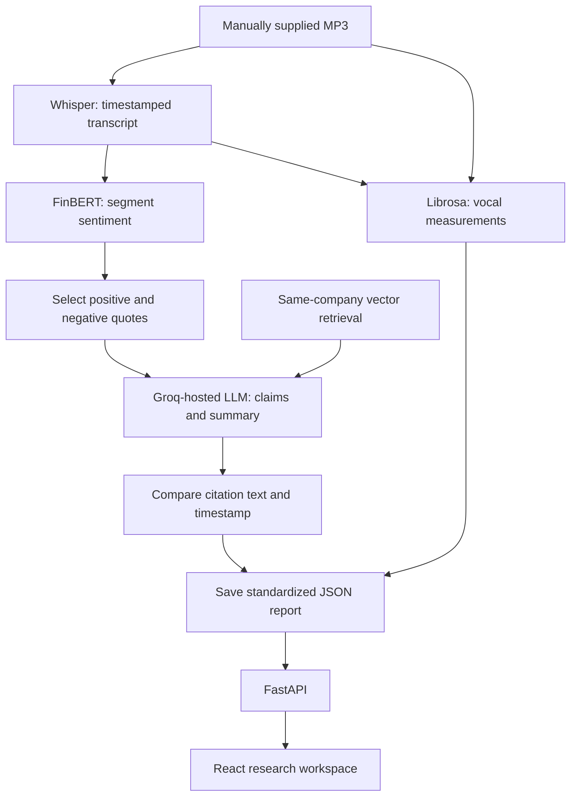

# Candor

### The story behind the numbers.

Candor is an earnings-call research prototype that connects generated claims to transcript quotes, timestamps and source audio. It combines speech recognition, financial sentiment classification, structured LLM generation and a separate citation-matching check in an editorial research interface.

The included dataset covers **16 calls across Apple, Microsoft, Nvidia and Meta**, with four quarters per company. Reports, transcripts and evaluation outputs are committed so the research library can run without model downloads, API keys or a vector database.

**A citation match confirms similar source text near a timestamp. It does not independently verify that the source supports the generated claim.**

[Quick start](#quick-start) · [How it works](#how-it-works) · [Evaluation](#evaluation) · [Known limitations](#known-limitations) · [Deployment](#deployment)

## Research workflow

- **Research desk:** browse reports, filter by company and search by company, ticker or quarter. Library figures come from the API.
- **Earnings brief:** read the summary, inspect transcript sentiment and view descriptive vocal measurements.
- **Claims and evidence:** follow a claim to its citation-match verdict, source quote and surrounding transcript passages.
- **Audio navigation:** select a timestamp to seek the source player; the evidence view highlights the cited passage in a waveform.
- **Methodology and evaluation:** inspect recorded baseline/structured results and per-call claim-coverage scores, with incomplete human review clearly labelled.

The frontend uses an ink, parchment and brass palette, Manrope for interface text and DM Serif Display for editorial headings. It includes responsive layouts, keyboard-operated report tabs and reduced-motion support. Report content is fetched from FastAPI rather than embedded in the frontend.

Audio playback requires the source MP3 to be available on the API server. A fresh clone and the public read-only deployment provide text-based research without those recordings.

## Quick start

Prerequisites: Python with `venv`, and Node.js **20.19+ within the 20.x series, or 22.12+** as required by the current Vite package. The existing local Python environment uses Python 3.13.

Clone the repository:

```bash
git clone https://github.com/Kruthi-choudary/candor-research.git
cd candor-research
```

**Terminal 1 — API serving the included reports:**

```bash
python3 -m venv .venv
source .venv/bin/activate
python -m pip install -r requirements-api.txt
READ_ONLY_MODE=true python -m uvicorn api.main:app --host 127.0.0.1 --port 8321 --reload
```

**Terminal 2 — frontend, starting from the repository root:**

```bash
cd frontend
npm ci
npm run dev
```

Open the URL Vite prints, normally **http://localhost:5173**. API documentation is at **http://127.0.0.1:8321/docs**. Vite proxies frontend `/api` requests to the backend on port `8321`.

This path does not install Whisper, FinBERT, the embedding model or Groq dependencies. `POST /analyze` returns `403` in read-only mode. Missing audio is reported in the interface while reports and transcripts remain usable.

## How it works



[`pipeline.py`](pipeline.py) coordinates the processing stages:

1. **Transcription:** `faster-whisper`, configured with `base.en`, converts the recording into text segments with start and end times.
2. **Sentiment:** `ProsusAI/finbert` classifies each non-empty segment as positive, negative or neutral. The reported distribution is the percentage of segments in each class, not a measure of investor opinion.
3. **Vocal measurements:** `librosa` extracts pitch, energy, pauses and speaking rate. These are summarized alongside the report; they are not inputs to claim generation.
4. **Retrieval:** LlamaIndex queries PostgreSQL/pgvector using `BAAI/bge-small-en-v1.5` embeddings. Results are filtered to the same company and exclude the current quarter. **Earlier-quarter filtering is not yet enforced**, so retrieved context can contain later information. If retrieval fails, processing continues without it.
5. **Generation:** the configured Groq-hosted model, `openai/gpt-oss-120b`, receives sentiment percentages, up to four positive and four negative source quotes, and optional retrieved context. It is asked to return one claim per quote and a short summary in a JSON-schema-constrained response. **It does not receive the full current-call transcript.**
6. **Citation matching:** a separate checker finds transcript segments starting within two seconds of each citation and checks normalized text similarity against a `0.6` threshold. Match results are recorded before the standardized report is saved; a failed match does not automatically remove the claim.

The final output contains claims, evidence, timestamps, sentiment distribution, citation-match counts, audio-feature summaries, retrieved context and stage durations. See an [included Apple report](data/processed/pipeline_runs/AAPL/Q1_2025.json) and the [report contract](src/common/schema.py). `risks` and `management_outlook` are reserved fields and currently empty.

### Architecture and storage

The React SPA requests data from FastAPI. The API reads saved JSON reports and intermediate outputs from `data/processed/`. In local processing mode, it can also invoke the pipeline. PostgreSQL/pgvector holds the optional retrieval index; it is not the main report store.

Vite suits the existing client-rendered research interface: report selection, evidence navigation and playback happen in the browser. The hosted frontend uses a rewrite to `index.html` so direct links and refreshes work with React Router.

| Layer | Implementation |
|---|---|
| Frontend | React 19, TypeScript, Vite 8, Tailwind CSS 4, React Router |
| Audio interface | Native audio controls and WaveSurfer.js |
| API | FastAPI and Uvicorn |
| Speech recognition | faster-whisper / `base.en` |
| Financial sentiment | Transformers / `ProsusAI/finbert` |
| Vocal measurements | librosa |
| Retrieval | LlamaIndex, PostgreSQL/pgvector, Hugging Face embeddings |
| Generation | Groq API with structured JSON output |
| Configuration | YAML files in `config/` |

These are integrations with existing models; the project does not train or fine-tune them. Dependency versions are recorded in the requirements files and frontend lockfile.

## Evaluation

### Citation matching

Recorded results from [`data/processed/eval/`](data/processed/eval/):

| Measure | Free-text baseline | Structured JSON |
|---|---:|---:|
| Citation-match rate | 81.4% | 100.0% |
| Citations matched | 70 / 86 | 128 / 128 |
| Recorded format-compliance value | 81.2% | 100.0% |

These results describe the included dataset under the implemented checkers. They do **not** establish 100% factual accuracy, complete claim support or the absence of hallucinations.

The comparison changes both generation format and checking procedure: the baseline uses regex parsing and a one-second timestamp tolerance; the structured checker uses a two-second tolerance and selects the most text-similar nearby segment. This is not a controlled experiment isolating the effect of JSON schema. The structured checker's format-compliance field counts processed report files against an expected 16; it is not an independent schema-validation score.

### Claim coverage

The coverage script greedily matches generated claims to reference claims using normalized text similarity with a `0.5` threshold.

| Call | Reference-label provenance | Precision | Recall | F1 |
|---|---|---:|---:|---:|
| AAPL Q1 2025 | Documented as human-labelled | 0.625 | 0.714 | 0.667 |
| META Q1 2025 | AI-drafted; human review pending | 0.750 | 0.750 | 0.750 |
| MSFT Q1 2025 | AI-drafted; human review pending | 0.875 | 0.875 | 0.875 |
| NVDA Q1 2025 | AI-drafted; human review pending | 0.875 | 0.875 | 0.875 |
| **Mean across four calls** | **Mixed provenance** | **0.781** | **0.803** | **0.792** |

The Apple provenance follows the repository's existing documentation; the other three [reference files](data/eval_labels/) explicitly carry `ai_drafted_pending_human_review`. The mean is not an independently human-validated quality score. Text similarity can also miss equivalent paraphrases or accept similar wording with different meaning.

### Recompute checks on saved outputs

With the API dependencies installed and the virtual environment active, run from the repository root:

```bash
python -m src.eval.check_citations_structured
python -m src.eval.check_claim_coverage
python -m src.eval.compare_runs
```

The first two commands recompute evaluation summaries from existing files without model calls or audio. They overwrite their corresponding saved summaries. `compare_runs` formats the saved baseline and structured results into `comparison.md`; it does not regenerate reports or rerun the original experiment. Per-call citation files served by the claims endpoint are written separately by `pipeline.py`.

## Run the processing pipeline locally

Full processing requires the heavier dependencies, source audio and a Groq key whenever new claims are generated. Models may download on first use.

From the repository root, with the virtual environment active:

```bash
python -m pip install -r requirements.txt
cp .env.example .env
```

Set `GROQ_API_KEY` in `.env`. Supply a recording at `data/raw/audio/{TICKER}/{QUARTER}.mp3`, for example `data/raw/audio/NVDA/Q1_2025.mp3`, then run:

```bash
python pipeline.py --ticker NVDA --quarter Q1-2025
```

**The pipeline checks for the MP3 before using cached outputs. Audio is required even when transcripts and features already exist.** Existing transcript, sentiment, audio-feature and claim files are reused by default. Retrieval and citation matching still run. Use `--force` only when you intend to recompute all cached stages, including transcription and audio features:

```bash
python pipeline.py --ticker NVDA --quarter Q1-2025 --force
```

To enable the local processing API after installing the full dependencies:

```bash
READ_ONLY_MODE=false python -m uvicorn api.main:app --host 127.0.0.1 --port 8321 --reload
```

The frontend currently browses saved reports; there is no upload or analysis-submission interface. The processing endpoint is synchronous and has no authentication, so the public deployment disables it.

For optional retrieval, configure a PostgreSQL database with the `vector` extension, update the connection settings in `config/pipeline.yaml`, and build the index:

```bash
python -m src.rag.build_index
```

The index is built from the saved transcripts. The current indexing script does not explicitly clear existing nodes, so repeated indexing should not be assumed to replace the index cleanly. Fixing chronological retrieval remains necessary even with a working database.

## API

| Method | Path | Purpose |
|---|---|---|
| GET | `/companies` | Configured company names and tickers |
| GET | `/calls` | Saved report summaries |
| GET | `/calls/{ticker}/{quarter}` | Standardized report |
| GET | `/calls/{ticker}/{quarter}/claims` | Claims with citation-match verdicts |
| GET | `/calls/{ticker}/{quarter}/transcript` | Timestamped transcript |
| GET | `/calls/{ticker}/{quarter}/audio` | MP3 when available; otherwise `404` |
| GET | `/eval/summary` | Saved citation and coverage results |
| POST | `/analyze?ticker=NVDA&quarter=Q1-2025` | Run the local pipeline; `403` in read-only mode |

Quarter inputs accept forms such as `Q1-2025` and `Q1_2025`. Interactive documentation is available at `/docs`.

## Project structure

```text
api/                    FastAPI routes and deployment-mode handling
config/                 Company registry and pipeline settings
src/
  common/               Call paths, configuration, report shape and errors
  data/                 Transcription and supporting data-collection scripts
  nlp/                  FinBERT sentiment classification
  audio/                Vocal-feature extraction
  rag/                  Vector indexing and retrieval
  report/               Free-text baseline and structured generation
  eval/                 Citation checks and claim-coverage evaluation
  analysis/             Separate stock-price reaction analysis
pipeline.py             Single-call processing coordinator
data/
  processed/            Included transcripts, reports, features and evaluations
  eval_labels/          Reference claims and available provenance metadata
  raw/                  Local source recordings and downloads; gitignored
frontend/               React research interface
render.yaml             Read-only API deployment configuration
```

The price-reaction and SEC-filing scripts are supporting experiments. They are not part of the main claim-generation workflow or currently exposed as frontend research features.

## Deployment

The repository supports a **read-only public demo**: the frontend browses included results while the API serves JSON files. No model inference or audio hosting is required for that mode.

| Setting | Render API | Vercel frontend |
|---|---|---|
| Repository | `Kruthi-choudary/candor-research` | `Kruthi-choudary/candor-research` |
| Branch | `main` | `main` |
| Root directory | Repository root | `frontend` |
| Build command | `pip install -r requirements-api.txt` | `npm run build` |
| Start / output | `uvicorn api.main:app --host 0.0.0.0 --port $PORT` | Output directory: `dist` |

Set `READ_ONLY_MODE=true` on the API and `ALLOWED_ORIGINS` to the exact frontend origin, without a trailing slash. Multiple origins can be comma-separated. Set the frontend's build-time `VITE_API_BASE_URL` to the API origin, without a trailing slash or `/api` suffix. For example, an API hosted at `https://your-api.onrender.com` serves `/calls` directly.

`READ_ONLY_MODE` and `ALLOWED_ORIGINS` are read from the API process environment; the API does not automatically load them from `.env`. `render.yaml` defines the read-only setting. `frontend/vercel.json` contains the SPA rewrite. Backend hosts that suspend idle services can make the first request slower.

## Known limitations

- **Incomplete evidence:** transcription segments can end mid-sentence. Selecting isolated fragments can change or obscure a claim's meaning.
- **Selection bias:** generation sees sentiment-selected quotes, not a comprehensive selection of financial facts or the full transcript.
- **Later-quarter leakage:** retrieval excludes the current quarter but does not enforce earlier dates; some saved reports already contain later-quarter context.
- **Limited verification:** citation matching checks text and time, not whether the evidence entails the claim. Failed matches remain in the saved report.
- **Limited reference labels:** only four calls have reference claims, three sets await human review, and provenance has not been independently audited.
- **No speaker identification:** transcript segments do not distinguish management, analysts or individual speakers.
- **Descriptive audio only:** vocal measurements are not validated indicators of confidence, deception or financial performance.
- **File-based caching:** cache reuse depends on file existence, without automatic invalidation when prompts, models or configuration change.

## Planned improvements

These are outstanding work, not completed features:

1. Construct complete evidence passages from adjacent transcript segments.
2. Enforce historical retrieval and regenerate affected reports.
3. Add an independent claim-support review alongside citation matching.
4. Expand independently human-reviewed reference claims and record reviewer provenance.
5. Add regression tests for misleading citations, missing data, temporal filtering and API failure cases.
