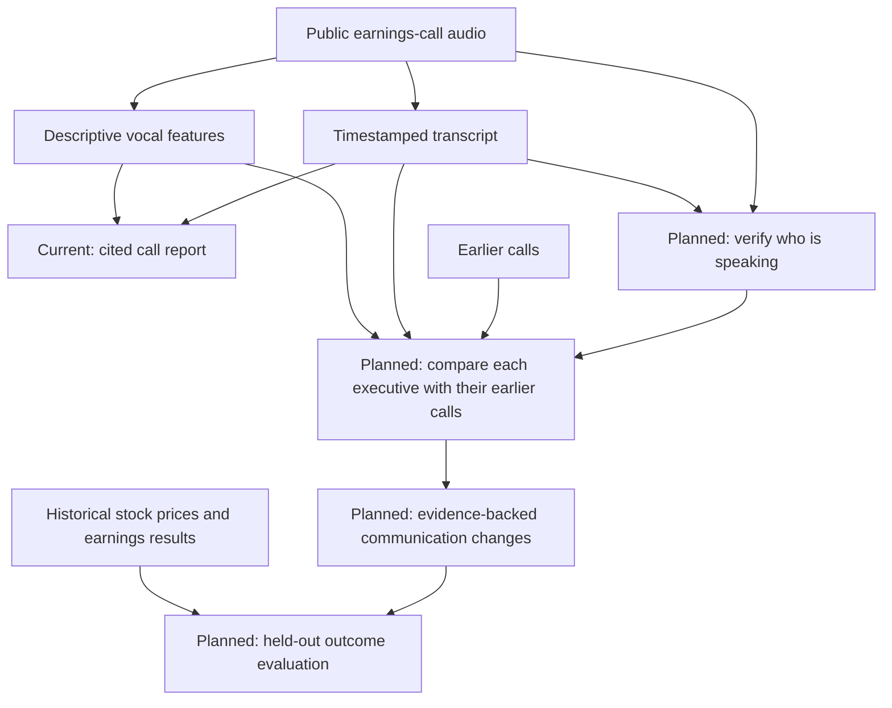

# Candor

**The story behind the numbers.**

An executive can sound positive in an earnings-call transcript while speaking more cautiously than in previous quarters. Spotting that difference means listening to the recording, reading the words, and knowing how that *same person* usually communicates. Candor's research goal is to bring those pieces together and point a reader to the exact evidence behind a possible change.

The original idea asks two separate questions: **Did the executive's language or voice change unusually? Were such changes associated with later financial outcomes?** Stock prices and earnings results belong to the second question: they help test whether a communication signal is useful, rather than define the signal itself. A vocal change alone does not establish stress or deception, and a later price move does not prove prediction or causation.

The current application does **not** answer those research questions yet. It transcribes calls, labels segment-level financial sentiment, measures basic audio features, and creates short reports with timestamped transcript citations. The interface lets readers move from a claim to its source passage and, when audio is available, seek the recording. Speaker identification, per-executive historical baselines, communication-deviation detection, and a valid financial-outcome backtest are unfinished.

The included dataset contains **16 calls: four quarters each for Apple, Meta, Microsoft, and Nvidia**. Saved reports and transcripts are included so the research library works without downloading models or supplying API keys. A bundled, clearly labelled demo appears immediately while the frontend connects to the FastAPI service.

## Run the application

Prerequisites: Python with `venv` and Node.js 20.19+ within the 20.x series, or 22.12+.

```bash
git clone https://github.com/Kruthi-choudary/candor-research.git
cd candor-research
python3 -m venv .venv
source .venv/bin/activate
python -m pip install -r requirements-api.txt
READ_ONLY_MODE=true python -m uvicorn api.main:app --host 127.0.0.1 --port 8321 --reload
```

In a second terminal, from the repository root:

```bash
cd frontend
npm ci
npm run dev
```

Open the URL printed by Vite, usually `http://localhost:5173`. The frontend can also run without the API using its bundled demo. The public read-only deployment does not include the source MP3s, so audio playback is available only where those recordings have been supplied locally.

## How Candor works and where it is going



`faster-whisper` creates timestamped transcript segments, FinBERT classifies their financial sentiment, and `librosa` extracts descriptive pitch, energy, pause, and speaking-rate features. Structured generation selects passages for claims; the application checks that each citation copies a supplied passage at its timestamp. Optional PostgreSQL/pgvector retrieval supplies passages from **earlier calls of the same company**. FastAPI serves saved JSON outputs to the Vite/React/TypeScript frontend. The project integrates existing models; it does not train them.

### Stock-price context

An early Candor experiment compares the stock's closing price around a call with the next trading day's close, alongside transcript sentiment. Its current 5% flag identifies a price move; it does **not** test whether a speaker's vocal or linguistic change predicted that move. A proper backtest would first need verified speaker-level measurements, earlier-call baselines, a defined prediction time and outcome window, and held-out evaluation. The [technical notes](docs/technical-notes.md#exploratory-stock-price-comparison) explain the existing calculation and its limits.

## What has been checked

- All 16 saved reports were regenerated and AI-assisted reviewed against their saved transcripts. Their current citations pass the exact-passage integrity check. **A matching citation does not prove that the claim is correct.** Independent human and recording review remain pending.
- The archived structured-generation experiment recorded 128/128 citation matches, compared with 70/86 for its free-text baseline. Those runs used different checking procedures, so the difference does not isolate the effect of structured output or measure factual accuracy. See [evaluation details](docs/technical-notes.md#evaluation).
- A two-call Nvidia speaker pilot records provisional prepared-remarks handoffs. Short local review clips and a validator exist, but voice identities have **not** been verified. No pilot segments are eligible for executive baselines. See [speaker pilot notes](docs/technical-notes.md#speaker-attribution-pilot).

## What remains

1. Independently review report claims against recordings and source material, and expand human-reviewed evaluation labels.
2. Verify speaker turns and keep executives separate from analysts before attributing measurements to a person.
3. Compare each executive only with their **earlier** calls, with enough history and comparable passages to support a baseline.
4. Evaluate text-only, audio-only, and combined deviation methods before presenting any communication-change finding in the product.
5. Only then test whether those measurements add any value for explaining or predicting later financial outcomes, using held-out calls and simple baselines.

Current audio features summarize calls that can mix speakers. They are **not** validated measures of confidence, stress, deception, or future financial performance.

## Further documentation

The [technical notes](docs/technical-notes.md) retain the full setup, report-by-report review history, evaluation methods, API routes, deployment settings, speaker pilot, and known limitations. Source records and versioned reports remain in [`data/processed/`](data/processed/). Run the Python regression suite with `python -m unittest discover -s tests -q`; frontend checks are `npm test`, `npm run build`, and `npm run lint` from `frontend/`.
